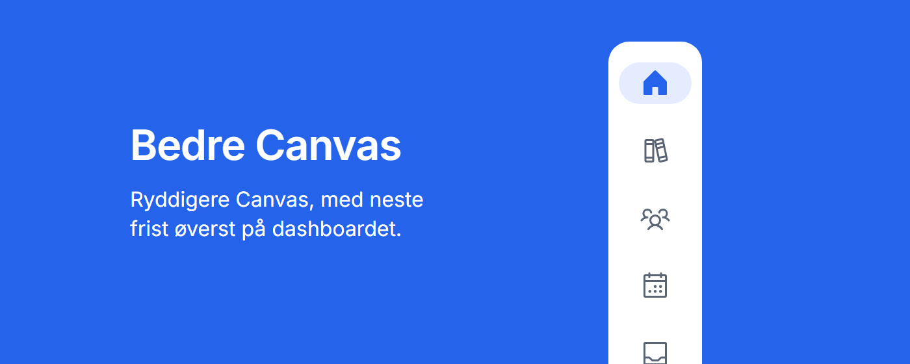

[](https://chromewebstore.google.com/detail/bedre-canvas/bceihlocdogakenkkccccekeggahmkpl)

[](https://chromewebstore.google.com/detail/bedre-canvas/bceihlocdogakenkkccccekeggahmkpl) [](https://chromewebstore.google.com/detail/bedre-canvas/bceihlocdogakenkkccccekeggahmkpl) [](LICENSE)

# Bedre Canvas

En Chrome-utvidelse som gir Canvas LMS et renere og mer moderne utseende, med en oversikt over
fristene dine på dashboardet.

*A Chrome extension that gives Canvas LMS a cleaner, more modern look and a clear overview of
your deadlines. The interface and docs are in Norwegian; issues and pull requests in English are
welcome too.*

- Fristoversikt på dashboardet: neste frist øverst med nedtelling, oppgaver du ikke har levert,
  en «Nå»-linje i tidslinjen og kunngjøringer adskilt fra frister
- Roligere sider: moduler, oppgaver, karakterer, kalender og innboks med lik og lettlest
  typografi
- En smal sidemeny med tydelige ikoner, og skuffer der hvert emne, hver gruppe og hver side i
  historikken har en fargebrikke
- Skolens egne Canvas-farger som standard, eller en farge du velger selv
- Lyst, mørkt eller automatisk tema

Bedre Canvas er ikke laget av eller tilknyttet Instructure, som lager Canvas LMS.

## Installer

**Fra Chrome Web Store:** [legg til Bedre Canvas i Chrome](https://chromewebstore.google.com/detail/bedre-canvas/bceihlocdogakenkkccccekeggahmkpl). Den oppdateres automatisk.

**Fra kildekoden:**

1. Last ned eller klon repoet
2. Åpne `chrome://extensions` og slå på **Utviklermodus** øverst til høyre
3. Klikk **Last inn upakket** og velg mappen
4. Åpne Canvas

Utvidelsen kjører automatisk på `*.instructure.com`. Bruker skolen din et eget domene
(f.eks. `canvas.skolen.no`), åpner du Canvas, klikker på utvidelsesikonet og velger
**Bruk på denne siden**.

## Personvern

Utvidelsen samler ikke inn, selger eller deler noe. Fristene og emnene dine hentes fra
Canvas-nettstedet du allerede er logget inn på, og vises bare i nettleseren din. Se
[personvernerklæringen](https://trygvedev.github.io/bedre-canvas/personvern/).

## Bidra

Feilrapporter, forslag og pull requests er velkomne. Se [CONTRIBUTING.md](CONTRIBUTING.md) for
hvordan du kommer i gang, og [RELEASING.md](RELEASING.md) for hvordan nye versjoner slippes.

## Struktur

| Fil | Hva den gjør |
| --- | --- |
| `manifest.json` | Oppsett for Chrome (Manifest V3) |
| `background.js` | Legger designet inn på nytt i åpne Canvas-faner når utvidelsen installeres eller oppdateres |
| `content/content.js` | Leser innstillinger og setter klasser på `<html>` |
| `content/canvas.css` | Grunnlaget for designet: tokens, typografi, meny, knapper, skjema. Alt er avgrenset til `html.bc` |
| `content/canvas-ui.css` | Canvas sine egne deler: topplinje, popovere, menyer, sidepaneler, kort- og aktivitetsvisning |
| `content/pages.css` | Sidene: emner, moduler, oppgaver, kunngjøringer, karakterer, kalender, innboks, skuffene i menyen |
| `content/icons.css` | Phosphor-ikoner og hvilke Canvas-ikoner de erstatter. Generert, se under |
| `content/dashboard.js` | Bygger fristoversikten fra `/api/v1/planner/items`, med avhuking |
| `content/dashboard.css` | Stil for fristoversikten, og skjuler Canvas sin egen visning |
| `content/calendar.js` | Får kalenderen til å passe i vinduet og plasserer hendelsesdetaljene |
| `content/trays.js` | Fargebrikker i skuffene for emner, grupper, historikk og hjelp |
| `popup/` | Innstillingsvinduet |
| `icons/app/` | Utvidelsens ikon i 16, 32, 48 og 128 px |
| `store/` | Skjermbilder og kampanjefliser til Chrome Web Store. Ikke en del av utvidelsen |
| `docs/` | Nettsiden (GitHub Pages): forsiden i `index.html` og personvernerklæringen |
| `tools/` | Skript for ikoner og pakking |

## Ikoner

Ikonene er [Phosphor Icons](https://phosphoricons.com) (Regular, MIT-lisens) og ligger i
`icons/phosphor`. Hvilket Canvas-ikon som blir hvilket Phosphor-ikon står i tabellene øverst i
`tools/build-icons.mjs`. Legg til en SVG og en linje i tabellen, og kjør:

```bash
node tools/build-icons.mjs
```

## Pakke for Chrome Web Store

```bash
python tools/package.py
```

Lager `dist/bedre-canvas-<versjon>.zip` med bare det Chrome trenger. Alt annet om oppføringen
(tekster, tillatelser, personvern, skjermbilder) står i `CHROMEWEBSTORE.md`.

## Lisens

[GPL-3.0](LICENSE). Du kan bruke, endre og dele koden, men versjoner du deler videre må også ha
åpen kildekode under samme lisens. Phosphor-ikonene har sin egen MIT-lisens i
[icons/phosphor/LICENSE](icons/phosphor/LICENSE).
